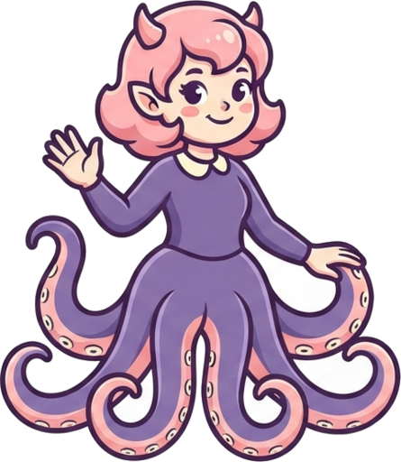
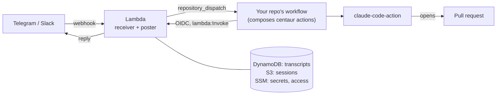

<p align="center">
  
</p>

# centaur

Chat with a Claude Code agent that lives in your GitHub repo. Message a Telegram or Slack bot; the
agent runs in GitHub Actions, answers in the thread, and proposes any change as a pull request you
review. No always-on server.

Status: built and validated live on Telegram (deploy, registration, replies, scheduled topics,
`respond_to: all`). Slack is implemented but has not been exercised end to end.

## What and why

Centaur was built for "reverse centaur" repos: a household garden-planning repo, say, where the
agent handles timing and outreach ("it is time to prune the tomatoes") and people do the physical
work and review the pull requests that record what the agent learned. It suits any repo where
you want to talk to an agent from your phone and keep its changes behind review.

- One chat bot per repo, on Telegram or Slack, chosen per repo.
- Replies and scheduled outreach are normal GitHub Actions runs of
  [`anthropics/claude-code-action`](https://github.com/anthropics/claude-code-action).
- The agent's file changes land as a pull request, never a push to the default branch.
- Costs are pay-per-token through your own Anthropic or OpenRouter API key.

## Architecture



One AWS Lambda per deployment receives every bot's webhook (via [Chat
SDK](https://github.com/vercel/chat)), stores the message, and dispatches a workflow in the bot's
repo. The workflow runs the agent with a context policy you choose per thread (`fresh`,
`transcript` or `resume`), then asks the Lambda to post the reply. Scheduled outreach is a
`schedule:` trigger on the same workflow. Details: [docs/plan.md](docs/plan.md).

## Demo

An illustrative exchange in a garden repo's chat:

```
Pat:     @garden_helper_bot the tomatoes have yellow leaves
Garden:  Likely early blight or a nitrogen shortfall. I read your bed notes: the
         tomatoes went in the shaded bed last spring. I've added a checklist
         to notes/tomatoes.md for you to check this weekend.
         Pull request: https://github.com/<you>/garden/pull/12
```

While the turn runs, the bot shows a 👀 reaction on the message. The pull request has a title and
body written by the agent, plus a footer linking the workflow run:

```
Add yellow-leaf checklist for tomatoes
  notes/tomatoes.md | 14 ++++++++++++++
```

You review and merge it; the next turn sees the new note.

## Adopt it in a repo

A repo needs three things, plus some Actions settings. Full steps:
[docs/onboarding.md](docs/onboarding.md#adding-a-repo).

**1. `.centaur.yml`** at the repo root ([every field](docs/config.md)):

```yaml
bot: garden
platform: telegram
respond_to: mention
context:
  default: transcript
  scheduled: fresh
provider: anthropic
model: sonnet
max_turns: 30
max_budget_usd: 1.0
allowed_tools: "Read,Edit,Write,Glob,Grep,WebFetch,WebSearch"
persona: .centaur/persona.md
prompts:
  weekly-tasks:
    destination: household
```

**2. Persona and prompts.** `.centaur/persona.md` is the agent's system prompt; each scheduled
prompt is a Markdown file at `.centaur/prompts/<name>.md`. For example, this repo's own test
persona:

```markdown
You are Centaur Test, a friendly assistant that lives in a chat group and answers questions about
this repository.

- Read the repository's files to answer; do not guess.
- Keep replies brief: a few sentences, plain text, no headings.
```

**3. Caller workflows** in `.github/workflows/`, one per concern: register, chat messages, and each
scheduled prompt ([full files](docs/workflows.md#consumer-workflows)). A scheduled prompt looks like:

```yaml
name: Centaur weekly tasks
on:
  schedule:
    - cron: "0 15 * * 6"
  workflow_dispatch:
permissions:
  contents: write
  pull-requests: write
  id-token: write
jobs:
  weekly-tasks:
    runs-on: ubuntu-latest
    steps:
      - uses: actions/checkout@v4
      - uses: blevinstein/centaur/.github/actions/setup-runtime@main
      - uses: blevinstein/centaur/.github/actions/turn@main
        with:
          prompt_name: weekly-tasks
          anthropic_api_key: ${{ secrets.ANTHROPIC_API_KEY }}
      - if: failure()
        uses: blevinstein/centaur/.github/actions/notify-failure@main
```

Pin `@main` to a tag or commit SHA for stability.

**Repository settings.**

- Actions variables (not secrets): `CENTAUR_ROLE_ARN`, `CENTAUR_AWS_REGION`,
  `CENTAUR_FUNCTION_NAME`, `CENTAUR_OIDC_AUDIENCE`, `CENTAUR_SESSION_BUCKET`. Their values come from
  the stack outputs ([docs/workflows.md](docs/workflows.md#variables-and-secrets)).
- Actions secret: `ANTHROPIC_API_KEY` or `OPENROUTER_API_KEY`, matching `provider`.
- Settings > Actions > General: allow Actions to create and approve pull requests.

## Quick start (maintainer)

Prerequisites: Node 24, `jq`, `zip`, and the AWS CLI with credentials for the target account.
Detail: [docs/deploy.md](docs/deploy.md), [docs/onboarding.md](docs/onboarding.md),
[docs/cli.md](docs/cli.md).

```sh
git clone https://github.com/blevinstein/centaur && cd centaur
npm ci

# 1. Deploy the stack (copy parameters.example.json to parameters-prod.json and fill it in first)
npm run deploy-prod

# 2. Install the CLI and point it at the stack's account and region
npm run build && npm link
export AWS_PROFILE=<profile> AWS_REGION=<region>

# 3. Store a GitHub token the Lambda uses to dispatch workflows (fine-grained PAT, Contents: write)
CENTAUR_BOT_GITHUB_TOKEN=<token> centaur github-token set

# 4. Create a bot with @BotFather, then store its token (prompted, never a flag)
centaur bot add garden --platform telegram
```

5. In the repo, add the three files above and set its variables and secret, then push
   `.centaur.yml` to the default branch. The `register` job binds the bot to the repo and sets the
   webhook.
6. Become the admin: `centaur admin claim garden`, open the link it prints, and tap **Start**.
7. Mention the bot from your chat. It DMs you an access request; react 👍 to approve the chat (and
   each person in it).

## Safety model

- **Admin approval only.** The agent holds repo write access and secrets, so only the platform's
  admin and the chats and users the admin approved can trigger turns. Approvals live in SSM, not in
  the repo, so a pull request cannot widen access. `.centaur.yml` has no allowlist. Unknown senders
  trigger an access request to the admin (👍 approves, 👎 denies and blocks); a bot creates at most
  10 requests per hour. See [access requests](docs/plan.md#access-requests).
- **No message content in GitHub.** Dispatch payloads carry IDs only; transcripts are fetched from
  the Lambda at run time and passed through files, not step inputs or environment variables.
  `show_full_output` is off and nothing is uploaded as an artifact. Chat thread IDs do appear in
  workflow concurrency group names and pull request branch names. See
  [docs/workflows.md](docs/workflows.md#keeping-content-out-of-github).
- **Cost caps.** `max_turns` (default 30) and `max_budget_usd` bound each run; `model`, `effort`
  and `allowed_tools` set its price. Tuning: [docs/config.md](docs/config.md#tuning-cost).
- **Reviewed changes.** The agent works through an explicit `allowed_tools` allowlist and its edits
  arrive as pull requests. Protect the default branch, because the dispatch token can also push.
  Fetched web pages are untrusted input; avoid tools that send data elsewhere
  ([docs/plan.md](docs/plan.md#security)).

## Limits and status

- Telegram is validated live; Slack is untested end to end.
- Pay-per-token: every non-ignored turn is a model run, and `respond_to: all` runs one for every
  message from an approved sender. Set a budget.
- One Lambda per deployment, shared by all bots and repos under the configured GitHub owner.
- The dispatch credential is a fine-grained PAT that expires and covers one owner.
- A second bot in one group and a consumer repo separate from this one are not yet verified. The
  list is in [docs/onboarding.md](docs/onboarding.md#still-unverified).

## Docs

- [docs/plan.md](docs/plan.md): architecture, components, security, access requests, SSM layout.
- [docs/config.md](docs/config.md): `.centaur.yml` reference.
- [docs/workflows.md](docs/workflows.md): shared workflows, caller workflow, variables, context
  policies.
- [docs/deploy.md](docs/deploy.md): CloudFormation stack and deploy script.
- [docs/cli.md](docs/cli.md): the `centaur` CLI (bots, admin, access, chat aliases, config check).
- [docs/onboarding.md](docs/onboarding.md): setup per platform and per repo.
- [docs/poster.md](docs/poster.md): the Lambda operations workflows invoke.
- [docs/research.md](docs/research.md): requirements and options considered.

Development: see [AGENTS.md](AGENTS.md). Tasks: [TODO.md](TODO.md).
