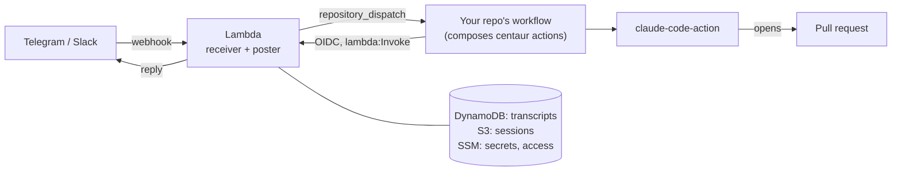

<p align="center">
  
</p>

# centaur

Turn any GitHub repo into a chat bot. Message a Telegram or Slack bot; a Claude Code agent runs in
GitHub Actions with your repo as its memory and toolbox, answers in the thread, and proposes any
change as a pull request you review. No always-on server.

- **Persistent memory.** The repo is the memory: the agent reads its files each turn, and what it
  learns lands as commits you can review. Threads can also replay their transcript or resume a
  saved session.
- **Tool use.** Per-repo tool allowlist, MCP servers, web access, and anything else
  [`claude-code-action`](https://github.com/anthropics/claude-code-action) can do.
- **Reviewed changes.** File changes arrive as pull requests. You approve them, or answer in PR
  comments and let the agent revise.
- **Scheduled actions** (optional). A cron-triggered prompt lets the agent reach out on its own
  ("it is time to prune the tomatoes").

Status: built and validated live on Telegram (deploy, registration, replies, scheduled topics,
`respond_to: all`). Slack is implemented but has not been exercised end to end.

## Demo

```
Pat:     @garden_helper_bot the tomatoes have yellow leaves
Garden:  Likely early blight or a nitrogen shortfall. I read your bed notes: the
         tomatoes went in the shaded bed last spring. I've added a checklist
         to notes/tomatoes.md for you to check this weekend.
         Pull request: https://github.com/<you>/garden/pull/12
```

You review and merge the pull request; the next turn sees the new note.

## Setup

1. **Deploy the AWS Lambda and infrastructure** once per account
   ([docs/deploy.md](docs/deploy.md)):

   ```sh
   git clone https://github.com/blevinstein/centaur && cd centaur
   yarn install --immutable
   yarn deploy-prod   # after copying parameters.example.json to parameters-prod.json
   yarn build && npm link   # installs the `centaur` CLI
   ```

2. **Add a `.centaur.yml` to each repo**, with a persona and caller workflows. Set its Actions
   variables with `scripts/set-repo-vars.sh` (reads them from the stack) and add the API key secret. Push it to the default branch to register the bot, then
   claim admin with `centaur admin claim <bot>`
   ([docs/onboarding.md](docs/onboarding.md#adding-a-repo), [config reference](docs/config.md)):

   ```yaml
   bot: garden
   platform: telegram
   persona: .centaur/persona.md
   ```

3. **Create each comms channel**: a Telegram bot (via @BotFather) and group, or a Slack app and
   channel, then store the token with `centaur bot add`. Mention the bot and approve the access
   request it DMs you ([docs/onboarding.md](docs/onboarding.md)).

4. **Optional: add scheduled actions**, a prompt file plus a `schedule:` workflow
   ([docs/workflows.md](docs/workflows.md#consumer-workflows)).

## Why it stays cheap and safe

- **Low cost, low maintenance.** One Lambda serves every bot and repo. Idle cost is near zero;
  you pay per token on your own Anthropic or OpenRouter key, bounded by `max_turns` and
  `max_budget_usd` ([tuning](docs/config.md#tuning-cost)).
- **Secrets stay in GitHub.** The model API key and tool secrets are repository Actions secrets,
  and bot tokens live in SSM. Dispatch payloads carry IDs only, so message content stays out of
  GitHub ([details](docs/workflows.md#keeping-content-out-of-github)).
- **Admin approval.** Only the platform admin and the chats and users the admin approved can
  trigger turns. Approvals live in SSM, so a pull request cannot widen access. Unknown senders
  trigger an access request (👍 approves, 👎 blocks)
  ([docs/plan.md](docs/plan.md#access-requests)).
- **Reviewed changes.** The agent works through an explicit `allowed_tools` allowlist and never
  pushes to the default branch. Protect that branch anyway, since the dispatch token can push.
  Fetched web pages are untrusted input ([docs/plan.md](docs/plan.md#security)).

## Architecture



The Lambda receives each bot's webhook (via [Chat SDK](https://github.com/vercel/chat)), stores the
message, and dispatches a workflow in the bot's repo. The workflow runs the agent, then asks the
Lambda to post the reply. Details: [docs/plan.md](docs/plan.md).

## Limits

- Telegram is validated live; Slack is untested end to end.
- Every non-ignored turn is a model run, and `respond_to: all` runs one for every message from an
  approved sender. Set a budget.
- One Lambda per deployment, shared by all bots and repos under the configured GitHub owner.
- The dispatch credential is a fine-grained PAT that expires and covers one owner.
- More unverified setups: [docs/onboarding.md](docs/onboarding.md#still-unverified).

## Docs

- [docs/onboarding.md](docs/onboarding.md): setup per platform and per repo.
- [docs/config.md](docs/config.md): config file reference.
- [docs/workflows.md](docs/workflows.md): shared workflows, caller workflow, variables, context
  policies.
- [docs/deploy.md](docs/deploy.md): CloudFormation stack and deploy script.
- [docs/cli.md](docs/cli.md): the `centaur` CLI.
- [docs/plan.md](docs/plan.md): architecture, components, security, access requests, SSM layout.
- [docs/poster.md](docs/poster.md): the Lambda operations workflows invoke.
- [docs/mcp.md](docs/mcp.md): MCP servers and operator policy.
- [docs/research.md](docs/research.md): requirements and options considered.

Development: see [AGENTS.md](AGENTS.md). Tasks: [TODO.md](TODO.md). Licensed under the
[MIT License](LICENSE).
